# LLM Router

A lightweight .NET-based routing layer for managing and load-balancing across multiple local LLM and image-generation inference servers.

## Overview

LLM Router provides a unified interface to route requests across heterogeneous backend inference engines — [llama.cpp](https://github.com/ggml-org/llama.cpp) builds (CPU, CUDA, Vulkan, SYCL, ...) and [Strata](https://github.com/Niko1221/Strata) for text, [stable-diffusion.cpp](https://github.com/leejet/stable-diffusion.cpp) for images — running on different machines or GPUs. It features:

- **Multi-protocol API gateway** — Exposes OpenAI-compatible (`/v1/chat/completions`, `/v1/responses`, `/v1/models`), Claude-compatible (`/v1/messages`), and Ollama-compatible (`/api/chat`, `/api/generate`, `/api/tags`, ...) endpoints in front of your backend servers.
- **Tool / function calling** — Passes OpenAI-style `tools`/`tool_choice` through to llama.cpp backends and translates the resulting tool calls back into Chat Completions or Responses API shapes.
- **OpenAI Responses API** — Stateful `/v1/responses` support (create, retrieve, delete, cancel) built on top of the same Chat Completions plumbing, with stored conversation state.
- **Smart routing** — Priority-ordered routing rules, preset/model affinity (auto-start or restart the server that owns a preset), and round-robin fallback across healthy instances.
- **Model aliases & fallback presets** — Extra names per preset (with `*` wildcards, e.g. `gpt-4o` or `claude-*`) for clients with hardcoded model ids, plus a fallback preset chain. The fallback serves when a preset's server is errored, and takes overflow when the preset is at capacity and the fallback is already loaded.
- **Memory groups & idle unload** — Servers sharing a GPU form a group with a VRAM budget. Before a model loads, the least-recently-used idle servers in the group are stopped until its estimated footprint fits. Servers can also unload after N idle minutes.
- **Image generation** — OpenAI `/v1/images/generations`, served by stable-diffusion.cpp presets with the same routing, fallbacks, memory groups, idle unload and queueing as chat. See [Image generation](#image-generation-stable-diffusioncpp).
- **Embeddings** — OpenAI `/v1/embeddings` and Ollama `/api/embed` / `/api/embeddings`, served by presets launched with embeddings enabled.
- **Health monitoring & auto-restart** — Background health checks detect failed or crashed backends and route around them.
- **Model library with Hugging Face integration** — A local registry of GGUF models with metadata inspection, folder scanning, and search/download directly from the Hugging Face Hub (with live progress).
- **Model presets** — Reusable llama.cpp launch configurations (sampling, context, GPU/threading, speculative decoding, LoRA, multimodal, etc.), optionally linked to a model-library entry so paths and metadata stay in sync.
- **Resilient backend supervision** — A separate wrapper process supervises each `llama-server` child process, so the router can restart without killing (or losing track of) running backends, and can live-swap models.
- **Request logging & stats dashboard** — Per-request API log with filtering, plus charts for throughput, latency, and context usage.
- **Playground** — Chat with any preset from the dashboard, with per-reply time to first token, prompt/generation speed, cache hits and speculative-decoding acceptance; every reply can be recorded with a snapshot of the preset's launch settings, so runs under different settings can be compared side by side and exported as CSV.
- **Razor Pages UI** — Web dashboard for managing servers, presets, the model library, request logs, and stats.

## Screenshots

| | |
|---|---|
| **Dashboard** — live server status, slot usage, 24h traffic | **Servers** — llama.cpp and Strata instances, status, port |
| 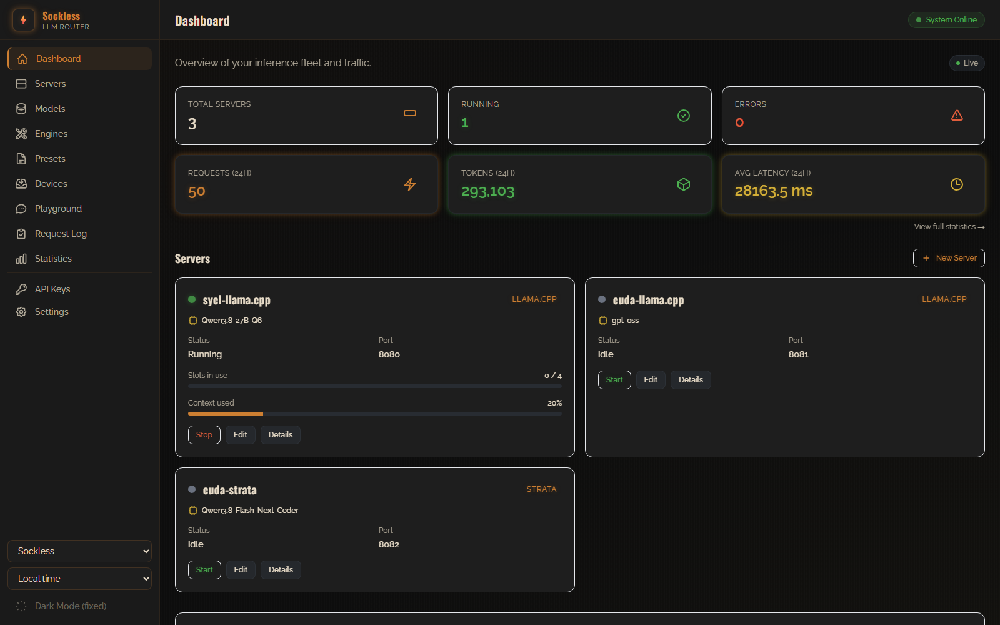 | 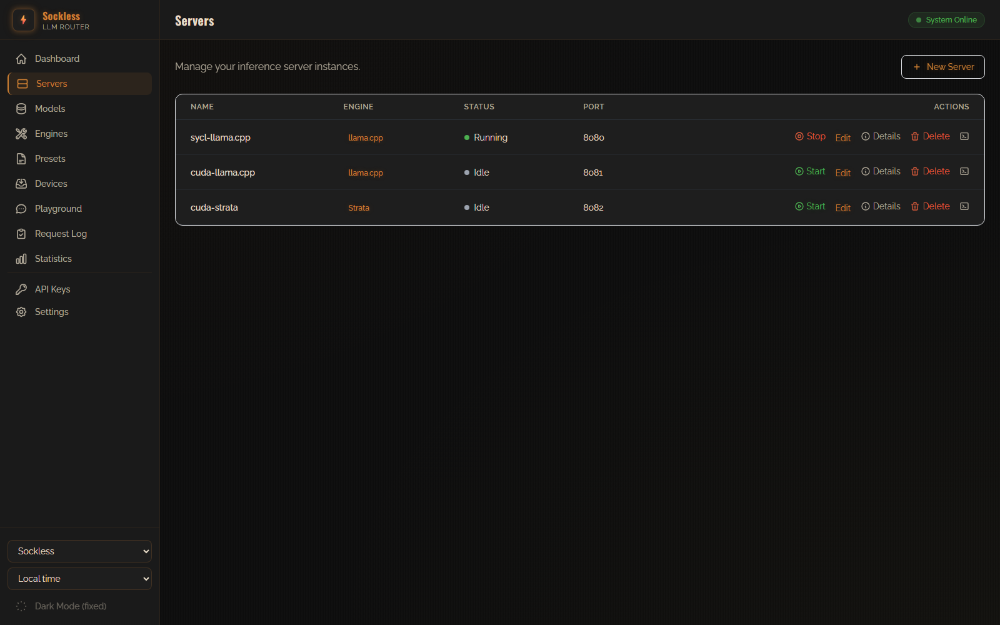 |
| **Engines** — installed llama.cpp builds and source recipes | **Strata** — installs, prepared models, update/rollback |
| 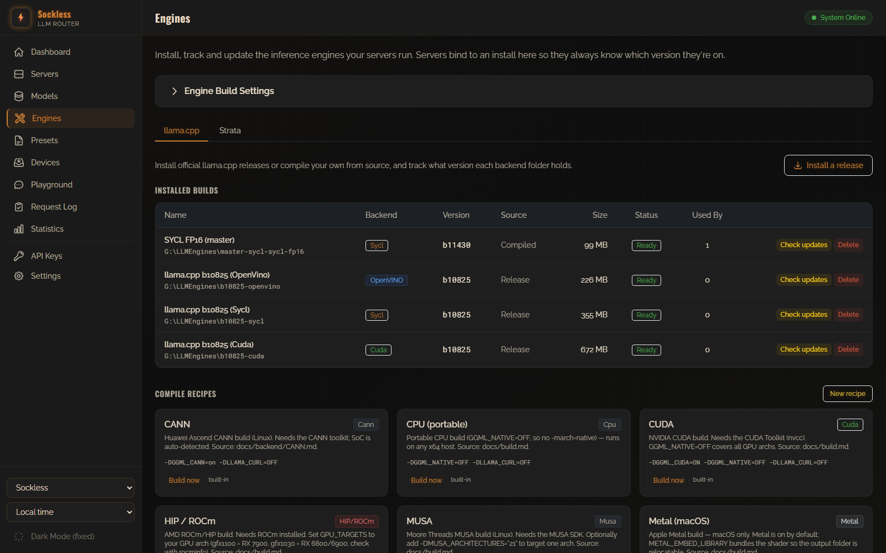 | 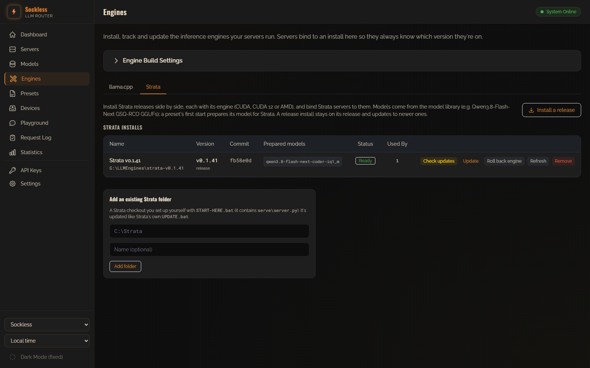 |
| **Presets** — launch configurations per server | **Model Library** — local and Hugging Face GGUFs with quant/size/status |
| 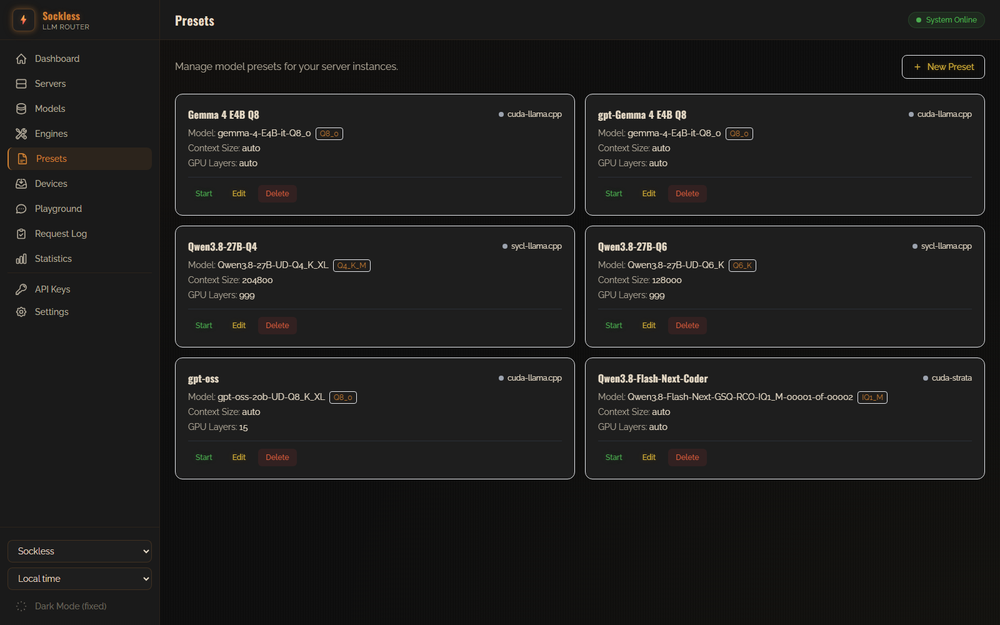 | 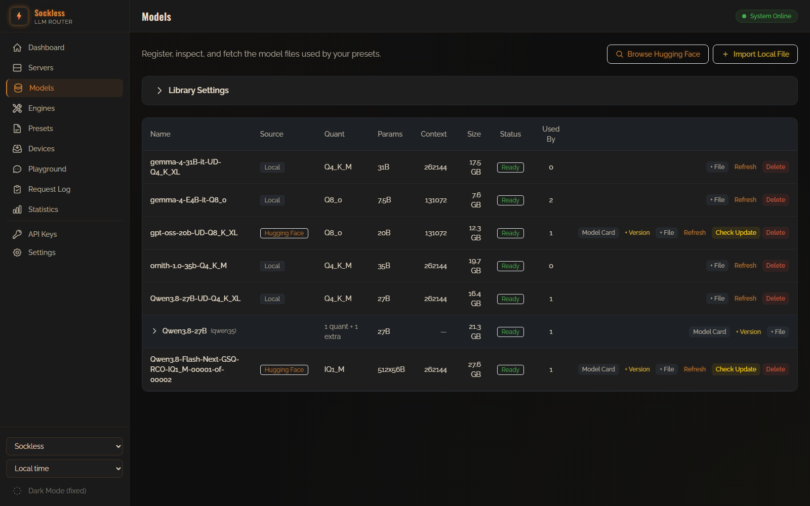 |
| **Playground** — run history comparing TTFT and speeds per configuration | **API Keys** — model-scoped keys, enable/disable, regenerate |
| 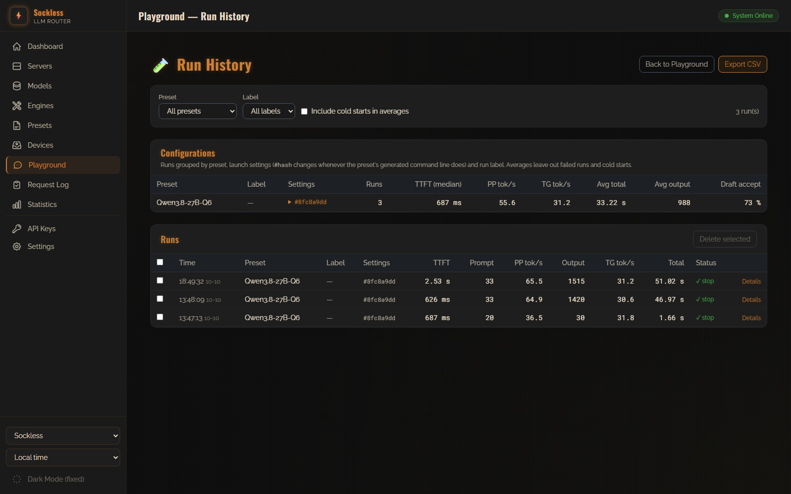 | 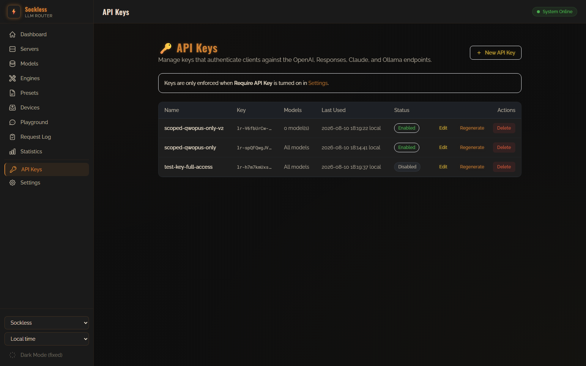 |
| **Statistics** — throughput, latency, context usage | **Request Log** — per-request history with filtering |
| 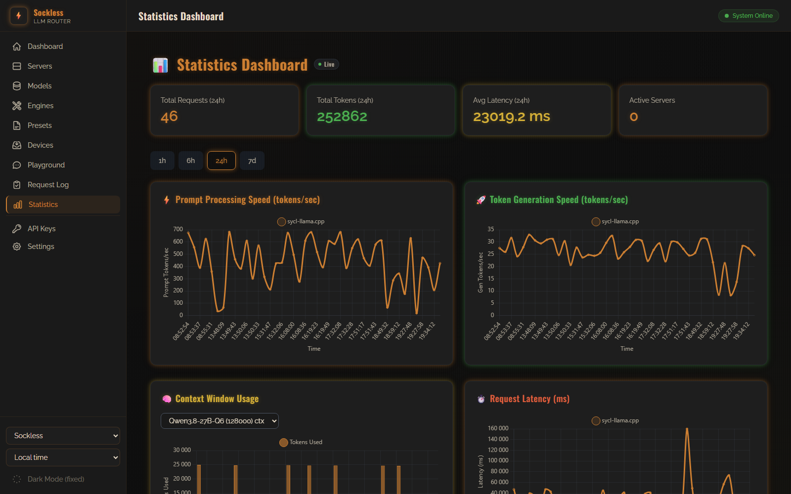 | 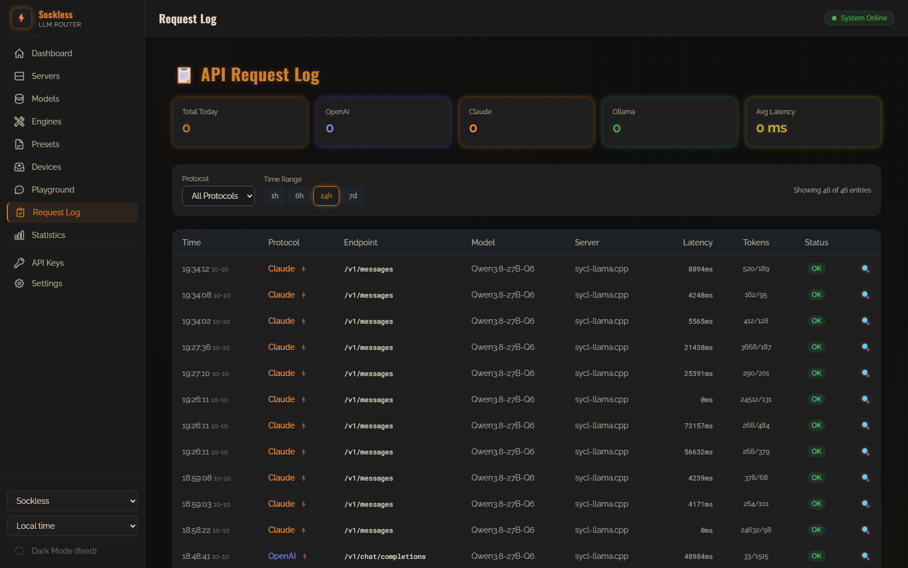 |

## Architecture

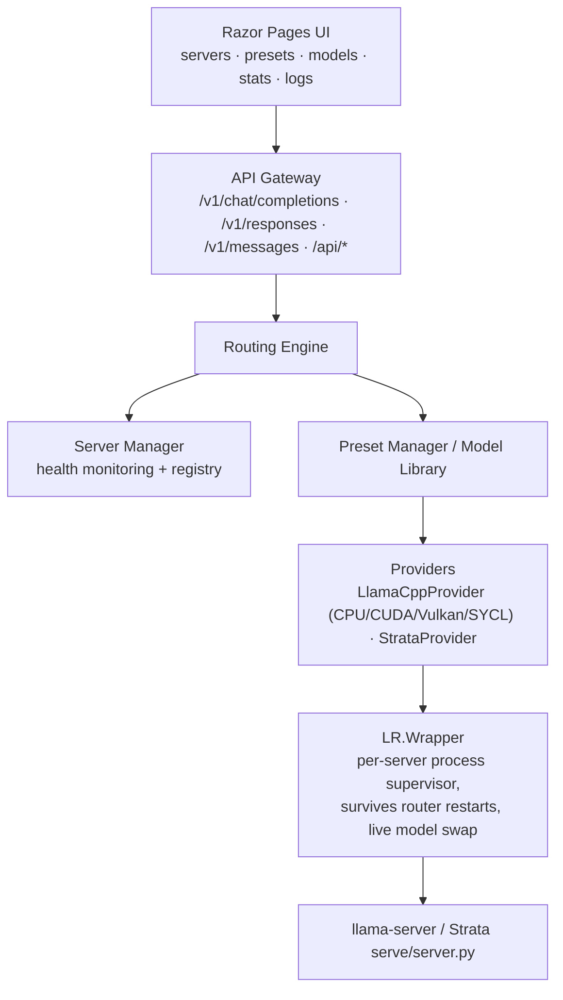

### Projects

| Project | Description |
|---|---|
| **LR.Application** | ASP.NET Core web app — Razor Pages UI, API endpoint mappings (OpenAI/Claude/Ollama/Responses), SignalR hubs, background services, Windows Service hosting |
| **LR.Core** | Core interfaces, EF Core models/migrations (SQLite), and services — routing engine, server/preset/model-library managers, Hugging Face client, request logging, wrapper protocol |
| **LR.Providers** | Backend engine providers: a shared base (`ManagedServerProviderBase` — wrapper process management, health, OpenAI/Anthropic request + SSE handling) with one folder per engine (`LlamaCpp/`, `Strata/`) |
| **LR.Wrapper** | Standalone process that launches and supervises a `llama-server` child process over a named-pipe protocol, so a router restart doesn't kill the backend |

## API

| Protocol | Endpoints |
|---|---|
| OpenAI | `POST /v1/chat/completions` (streaming + non-streaming, tool calling), `POST /v1/embeddings`, `POST /v1/images/generations`, `GET /v1/models` |
| OpenAI Responses | `POST /v1/responses`, `GET /v1/responses/{id}`, `DELETE /v1/responses/{id}`, `POST /v1/responses/{id}/cancel` |
| Claude | `POST /v1/messages` |
| Ollama | `POST /api/chat`, `POST /api/generate`, `GET /api/tags`, `POST /api/show`, `POST /api/embed`, `POST /api/embeddings`, `GET /api/ps`, `GET /api/version` |
| Misc | `GET /health`; SignalR hubs `/serverHub` and `/modelDownloadHub` for live UI updates |

Protocols are toggled via `Gateway:EnabledProtocols` in configuration. Only `"function"`-type tools are supported for tool calling and the Responses API — OpenAI's built-in tools (web search, file search, code interpreter, computer use, image generation, MCP) and the Conversations API are not implemented.

## Getting Started

### Prerequisites

- .NET 10.0 SDK or later
- Node.js/npm (to build the Tailwind CSS bundle — see below)
- For llama.cpp servers: `llama-server`/`llama-server.exe` binaries for whichever backend(s) you plan to run (CPU/CUDA/Vulkan/SYCL) — downloaded/compiled from the Engines page or your own builds
- For Strata servers: Git and Python 3.10+, plus a C++ toolchain (Visual Studio Build Tools on Windows, `build-essential` on Linux) when Strata has to compile its engine — always on Linux, and on Windows only if no ready-made engine fits the PC. The Strata releases page checks these and refuses an install until they're found (installed from the Engines page — see [Strata servers](#strata-servers))

### Building the frontend assets

```bash
cd LR.Application
npm install
npm run build:css
```

### Running the Application

#### Standalone (console)

```bash
dotnet run --project LR.Application
```

The application will start, apply any pending SQLite migrations (`data/lr.db`), and serve the Razor Pages dashboard. Add servers, presets, and model-library entries from the UI — there's no need to hand-edit configuration for routing data.

#### As a Windows Service

The same executable can run under the Service Control Manager — it detects how it was
launched and adapts automatically (no separate build or flag required).

1. Download a release from the
   [GitHub Releases](https://github.com/sockless-coding/llm-router/releases) page and
   extract it to the folder the service should run from:

   - `llm-router-<version>-win-x64.zip` — framework-dependent; requires the
     [.NET 10 runtime](https://dotnet.microsoft.com/download/dotnet/10.0) (ASP.NET Core).
   - `llm-router-<version>-win-x64-self-contained.zip` — includes the runtime.

2. Install the service from the extracted folder (run PowerShell as Administrator):

   ```powershell
   .\install-service.ps1
   ```

   By default this creates a service named `LLMRouter` pointing at the
   `LR.Application.exe` in the same folder as the script. Pass `-PublishDir` to point
   at a different folder.

   To test a local build as a service, run `publish.bat` from the repo root (it
   publishes to `publish\`), then install with `.\install-service.ps1 -PublishDir .\publish`.

3. Start it:

   ```powershell
   Start-Service LLMRouter
   ```

   Logs go to the Windows Event Log (source `LLM Router`, log `Application`) since
   there's no console attached when running as a service.

4. To remove it (run as Administrator):

   ```powershell
   .\uninstall-service.ps1
   ```

#### Updating

**Settings → Updates** shows the installed version and the latest
[release](https://github.com/sockless-coding/llm-router/releases). When the router runs as a
Windows Service, **Install and restart** updates it in place:

1. The router downloads the release archive matching the install (framework-dependent or
   self-contained), checks its SHA-256 digest and extracts it to `data\updates\`.
2. It launches the new version's `LR.Application.exe` in updater mode. That process stops the
   service, copies the new files over the install folder and starts the service again.
3. If any file can't be replaced, everything is rolled back and the old version is restarted.

`data\` (database, wrapper state, engine builds) and an existing `appsettings.json` are never
overwritten. Requests in flight when the service stops are cut off. Running model servers keep
running, and the restarted router reconnects to them. Their wrapper processes keep the old
`LR.Wrapper.exe` until they're next restarted. The outcome is shown on the Settings page, and
`data\updates\update.log` has the details.

When the router isn't running as a service (console or `dotnet run`), the page still checks for
updates, but you install them by replacing the files yourself.

## Using the dashboard

- **Servers** — register backend server instances, pick their engine (llama.cpp, Strata or stable-diffusion.cpp), point them at a build / Strata folder, start/stop/restart them, and view live logs and status.
- **Presets** — define launch configurations (model path, context size, sampling parameters, GPU/threading, speculative decoding, LoRA, multimodal settings, etc.), optionally linked to a model-library entry so the model path and GGUF metadata stay in sync automatically.
- **Model Library** — import existing `.gguf` (and, for diffusion models, `.safetensors`) files, scan a folder for unregistered models, or search and download models from the Hugging Face Hub with live progress; inspect GGUF metadata per model.
- **Stats** — throughput, latency, and context-usage charts.
- **Playground** — chat with a preset and see per-reply performance stats (TTFT, prompt/generation tok/s, cached tokens, draft acceptance). Tag runs with a label (e.g. `fa=on ub=1024`), use *Repeat ×N* to average out noise, and compare configurations on the **Run history** page — runs are grouped by preset, label and a hash of the preset's generated command line, so editing a preset automatically starts a new group. Runs aren't subject to request-log retention.
- **Request Log** — browse and filter logged API requests by protocol and time range.
- **Settings** — app-level configuration, including the model library's root folder and Hugging Face API token.

### Strata servers

[Strata](https://github.com/Niko1221/Strata) runs large Mixture-of-Experts models (Qwen3.8-Flash-Next) on consumer GPUs by offloading dormant experts to system RAM. It's set up the same way as llama.cpp:

1. **Engines → Strata → Install a release**: pick a release and its engine build — CUDA, CUDA 12 (older NVIDIA drivers) or AMD. The router clones that release into `<install root>/strata-<tag>-<engine>`, creates its `.venv` with Strata's pinned Python packages, and installs the engine, checked against the SHA-256 GitHub publishes for it. No model is installed. (Linux has no ready-made engines; Strata compiles one when a model is first prepared.)
2. **Models → Hugging Face**: download a Qwen3.8-Flash-Next GGUF, e.g. `ISTA-DASLab/Qwen3.8-Flash-Next-GSQ-RCO-GGUF` → `IQ3_XXS` (Swift 1.5, the Coder and Unsloth's quants work too). Split models are one entry: all shards are downloaded together.
3. **Servers**: create a server with engine **Strata**, bound to the install.
4. **Presets**: pick the model from the library and, in the **Strata** section, the context length, GPU, images, KV cache type, low-RAM mode and parallel requests (blank = Strata's recommendation for this PC). Start it.

The first start of a preset prepares its model for Strata with Strata's own `setup.py` in its existing-GGUF mode (`--gguf-dir`): it builds the model's pack, downloads the ~5 GB MTP draft layer once (shared by all models), and writes a run config tuned to this PC, which the router keeps per preset. Progress shows in the server's start status and log. This can take several minutes (longer in low-RAM mode, which writes the experts into one 35–77 GB file once); later starts skip it until the model, the preset's Strata settings or the install change. Prepared packs and the draft layer live in Strata's shared `Strata-data` folder next to the install. The server then runs as Strata's own `run-<model>` scripts would — `.venv` Python with `serve/server.py --engine strata --config <run config>` — on the router-assigned port, bound to `127.0.0.1`.

The Strata tab shows each install's version, commit, engine version and prepared models. It can check for updates (a release install against the latest release), update in place (a release install checks out the new tag and installs that release's same engine build; refused while a server is running from it), roll back the engine, or stop tracking an install (its files are never deleted). A Strata folder you set up yourself with `START-HERE.bat` can be added too; it updates like Strata's `UPDATE.bat`, and a preset can also point straight at one of its `strata-<model>.json` run configs.

If a run config (or `STRATA_API_KEY`) sets an API key, the router sends it automatically. Strata's `/props` and `/slots` mirror llama.cpp's, so slot-based concurrency limits, context-aware queuing, and the dashboard's slot/KV usage work the same as for llama.cpp servers.

### Image generation (stable-diffusion.cpp)

[stable-diffusion.cpp](https://github.com/leejet/stable-diffusion.cpp) servers generate images and follow the same server → engine → model → preset flow as the LLM engines:

1. **Engines → stable-diffusion.cpp → Install a release**: pick a release and a backend (CPU, CUDA, Vulkan, ROCm on Windows; CPU, Vulkan, ROCm on Linux; Metal on macOS). Windows CUDA builds come with their CUDA runtime. Installs can be checked for updates and updated in place like llama.cpp builds. For a backend with no official release (e.g. **SYCL** for Intel GPUs), compile one from a **recipe** on the same tab — built-ins cover CPU, CUDA, Vulkan, SYCL FP32/FP16, HIP and Metal, taken from sd.cpp's `docs/build.md`, and work exactly like llama.cpp recipes (duplicate and adjust, rebuild/update from source).
2. **Models**: import the model files — `.gguf` or `.safetensors`. A full checkpoint (SD 1.x/2.x/SDXL) is one file; a standalone diffusion model (Flux, SD3, Qwen-Image, Z-Image…) also needs its VAE and text encoder(s).
3. **Servers**: create a server with engine **stable-diffusion.cpp**, bound to the install.
4. **Presets**: pick the main model and, in the **Diffusion** section, its VAE/text encoders (CLIP-L, CLIP-G, T5-XXL, LLM), the default size, steps, CFG scale, sampler, scheduler, seed and negative prompt, and performance options (weight type, flash attention, CPU offload, VAE tiling, …). The command preview shows the resulting `sd-server` command line.

Clients call `POST /v1/images/generations` with the preset's name (or an alias) as `model`:

```bash
curl http://localhost:5053/v1/images/generations -H "Content-Type: application/json"   -d '{"model": "flux-schnell", "prompt": "a lighthouse at dusk", "size": "1024x768", "n": 1}'
```

The response is OpenAI's `{"created": ..., "data": [{"b64_json": "..."}]}` (images are always returned as base64; `response_format: "url"` isn't supported). Besides `prompt`, `n`, `size` and `output_format`, the router accepts the common extras `negative_prompt`, `seed`, `steps`, `cfg_scale`, `guidance`, `sampler`/`sample_method` and `scheduler`, and passes them to stable-diffusion.cpp as `<sd_cpp_extra_args>`; a client's own `<sd_cpp_extra_args>` block in the prompt still works and wins. Anything a request doesn't set falls back to the preset's defaults.

Image presets are kept apart from chat: they don't appear in `/api/tags` or `/v1/models/capabilities`, a chat request naming one gets a 400 pointing at the images endpoint, and unresolved chat models are never round-robined onto an image server (or the reverse). `sd-server` generates one image job at a time, so the router sends each server one request at a time and queues the rest. A preset's memory-group footprint is its model files plus compute buffers (only the largest file with CPU offload). Request-log entries keep the request and a summary of the response, with the base64 image data left out.

**Playground → Generate**: picking an image or video preset in the Playground opens the Generate page, which runs on stable-diffusion.cpp's native job API rather than the OpenAI endpoint, so it can show sampling progress with live previews and take image inputs. It offers image mode (batch size, image-to-image with strength, inpainting masks) and video mode (frames, FPS, start/end frames; Wan, LTX, HunyuanVideo and other video models), plus size, steps, CFG, guidance, sampler, scheduler, seed, LoRAs from the server's LoRA folder, output format and preview mode. Once the model is loaded, the page reads the server's capabilities to show only the modes and inputs it supports, list its samplers and LoRAs, and use its defaults as placeholders. A generation goes through routing like any request (model auto-start, fallback, memory groups) and holds the server's slot until the job ends, so idle unload and memory-group eviction leave it alone mid-job; Stop (or leaving the page) cancels the job on the server. Results stay on the page until you leave; download the ones to keep. Each generation is written to the request log with images left out.

### Adding another engine

1. Add a value to `ServerEngine` (append; values are persisted).
2. Implement an `IBackendProvider`. For an engine that runs as a local OpenAI-compatible HTTP server, derive from `ManagedServerProviderBase` and implement `BuildLaunchSpec` (what to launch) plus `IsModelLoadedLine`/`TryParseListeningPort` (how its output signals readiness); override the optional hooks for request headers, out-of-band metrics, or a longer startup timeout.
3. Implement an `IEngineDescriptor` (display name, what it generates — `EngineModality.Text` or `Image`, provider type, install-folder help and validation, what a preset's model path means, and its preset-form section if its settings live in `ModelPreset.EngineSettings`) and register it in `ServiceCollectionExtensions.AddBackendEngines`.
4. Optionally, version management on the Engines page: an `IEngineInstallHandler` (upstream repo, how to tell a ready install from a missing one, what to compare updates against), and a tab partial `Pages/Features/Engines/Tabs/_<Engine>.cshtml`. An engine that publishes prebuilt server binaries on GitHub releases only needs an `EngineReleaseProfile` (repo, asset patterns per backend/OS, executable name — see `SdCppReleaseProfile`) to reuse the release install/update pipeline and the shared `_ReleaseBuilds` table; anything else gets its install/update jobs in an `EngineBuildService` partial (see `EngineBuildService.Strata.cs`). Installs are rows in `EngineBuilds` with their `Engine` set, so servers bind to them the same way for every engine.

The server pages, Engines tabs, provider factory, routing, and dashboards pick the new engine up from the catalog. Implementing `IServerCapacityProvider` (which the base class does) opts it into slot-based concurrency gating.

## Configuration

Edit `LR.Application/appsettings.json` for gateway-level settings (port, enabled protocols, request queueing/timeouts, request logging). Servers, presets, and the model library are managed through the dashboard and persisted to a local SQLite database (`data/lr.db`), not in `appsettings.json`.

## License

This project is licensed under the MIT License — see the [LICENSE](LICENSE) file for details.
