# LLM Router

A lightweight .NET-based routing layer for managing and load-balancing across multiple local LLM and image-generation inference servers.

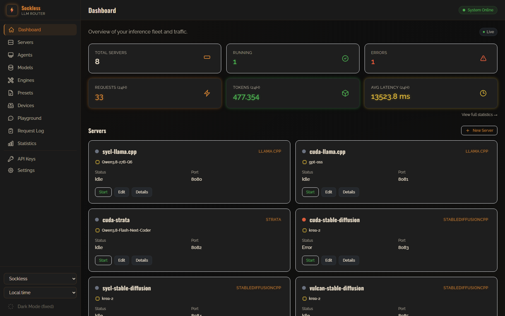

## Supported engines

One OpenAI / Claude / Ollama-compatible endpoint in front of five inference engines, mixed freely across GPUs and machines. Each one is installed, updated and supervised from the dashboard's **Engines** page, so there's no separate setup per engine.

| Engine | Serves | Models | Hardware | Installed from |
|---|---|---|---|---|
| [**llama.cpp**](https://github.com/ggml-org/llama.cpp) | Chat, embeddings, [System One](#system-one-decision-models-jev) decisions (Jev) | GGUF | CPU, CUDA, Vulkan, SYCL, OpenVINO, HIP/ROCm, Metal, CANN, MUSA | Official releases, or compiled from built-in recipes |
| [**Strata**](https://github.com/Niko1221/Strata) | Chat (large MoE models on consumer GPUs) | Qwen3.8-Flash-Next GGUF | NVIDIA CUDA / CUDA 12, AMD | Releases, cloned with their own Python venv |
| [**vLLM**](https://github.com/vllm-project/vllm) | Chat, with vLLM's own batching | Hugging Face checkpoints, presets from [recipes.vllm.ai](https://recipes.vllm.ai) | NVIDIA CUDA (Linux, or WSL on Windows), Intel XPU (Docker Desktop) | Self-contained `uv` venv per version, or a managed Docker image |
| [**TensorFold**](https://github.com/ashhart/TensorFold) | Chat, with speculative decoding and prompt cache | Hugging Face checkpoints (MLX, NVFP4/FP8, EXL3, …) | NVIDIA CUDA, Apple Metal, AMD HIP, Intel XPU (Linux, or Docker Desktop on Windows) | Official releases (Linux, macOS), compiled from recipes (Windows), or a managed Docker image |
| [**stable-diffusion.cpp**](https://github.com/leejet/stable-diffusion.cpp) | Images and video | GGUF / safetensors (SD 1.x–SDXL, SD3, Flux, Qwen-Image, Wan, …) | CPU, CUDA, Vulkan, ROCm, Metal, SYCL | Official releases, or compiled from built-in recipes |

Per-engine setup: [llama.cpp](#using-the-dashboard) · [Strata](#strata-servers) · [vLLM](#vllm-servers) · [TensorFold](#tensorfold-servers) · [stable-diffusion.cpp](#image-generation-stable-diffusioncpp). Adding another engine is a matter of implementing a few interfaces; see [Adding another engine](#adding-another-engine).

## Overview

LLM Router provides a unified interface to route requests across these heterogeneous backends, running on different machines or GPUs. It features:

- **Multi-protocol API gateway** — Exposes OpenAI-compatible (`/v1/chat/completions`, `/v1/responses`, `/v1/models`), Claude-compatible (`/v1/messages`), and Ollama-compatible (`/api/chat`, `/api/generate`, `/api/tags`, ...) endpoints in front of your backend servers.
- **Tool / function calling** — Passes OpenAI-style `tools`/`tool_choice` through to llama.cpp backends and translates the resulting tool calls back into Chat Completions or Responses API shapes.
- **OpenAI Responses API** — Stateful `/v1/responses` support (create, retrieve, delete, cancel) built on top of the same Chat Completions plumbing, with stored conversation state.
- **Smart routing** — Priority-ordered routing rules, preset/model affinity (auto-start or restart the server that owns a preset), and round-robin fallback across healthy instances.
- **Model aliases & fallback presets** — Extra names per preset (with `*` wildcards, e.g. `gpt-4o` or `claude-*`) for clients with hardcoded model ids, plus a fallback preset chain. The fallback serves when a preset's server is errored, and takes overflow when the preset is at capacity and the fallback is already loaded.
- **Memory groups & idle unload** — Servers sharing a GPU form a group with a VRAM budget. Before a model loads, the least-recently-used idle servers in the group are stopped until its estimated footprint fits. Servers can also unload after N idle minutes.
- **Image generation** — OpenAI `/v1/images/generations`, served by stable-diffusion.cpp presets with the same routing, fallbacks, memory groups, idle unload and queueing as chat. See [Image generation](#image-generation-stable-diffusioncpp).
- **Embeddings** — OpenAI `/v1/embeddings` and Ollama `/api/embed` / `/api/embeddings`, served by presets launched with embeddings enabled.
- **System One decisions (Jev)** — `POST /v1/systemone`, the TypeSafe/Jev-compatible decision API: native decision models (OpenJev, Laya, Kev, …) score typed questions about a state in one forward pass instead of generating text. Routed, queued and logged like chat, with a **Decide** page in the Playground. See [System One](#system-one-decision-models-jev).
- **Health monitoring & auto-restart** — Background health checks detect failed or crashed backends and route around them.
- **Model library with Hugging Face integration** — A local registry of GGUF files, safetensors files and checkpoint folders, with metadata inspection, folder scanning, and search/download directly from the Hugging Face Hub (with live progress). Each model shows which engines can run it.
- **Shared engine and model folders** — Several router instances can point at the same engine install root and model root. Installs and model files that one instance adds show up in the others within a few minutes, or straight away with **Scan** on the Engines and Models pages. Models are linked to the Hugging Face repo they came from, so update checks work everywhere. Each install and download leaves a small `.llm-router-*.json` manifest next to its files. Older files without one are matched by their folder layout (and checked against the Hub).
- **Device overview** — The Devices page lists the GPUs/NPUs on the machine, their VRAM and the compute APIs that likely work on them, and can enable or disable them in Windows.
- **Model presets** — Reusable per-engine launch configurations (sampling, context, GPU/threading, speculative decoding, LoRA, multimodal, etc.), optionally linked to a model-library entry so paths and metadata stay in sync.
- **Remote agents** — Run servers on other machines (Windows, Linux x64 and arm64). A one-line install command sets up an agent that connects back to the router, installs engines and models on its own disk when told to, supervises its backends, and updates itself whenever the router ships a new version. See [Remote agents](#remote-agents).
- **Resilient backend supervision** — A separate wrapper process supervises each backend process, so the router can restart without killing (or losing track of) running backends, and can live-swap models.
- **Request logging & stats dashboard** — Per-request API log with filtering, plus charts for throughput, latency, and context usage.
- **Playground** — Chat with any preset from the dashboard, with per-reply time to first token, prompt/generation speed, cache hits and speculative-decoding acceptance; every reply can be recorded with a snapshot of the preset's launch settings, so runs under different settings can be compared side by side and exported as CSV.
- **Razor Pages UI** — Web dashboard for managing servers, presets, the model library, request logs, and stats.

## Screenshots

| | |
|---|---|
| **Servers** — llama.cpp, Strata, vLLM, TensorFold and stable-diffusion.cpp instances side by side | **Model Library** — GGUFs, safetensors and checkpoints, with the engines that can run each |
| 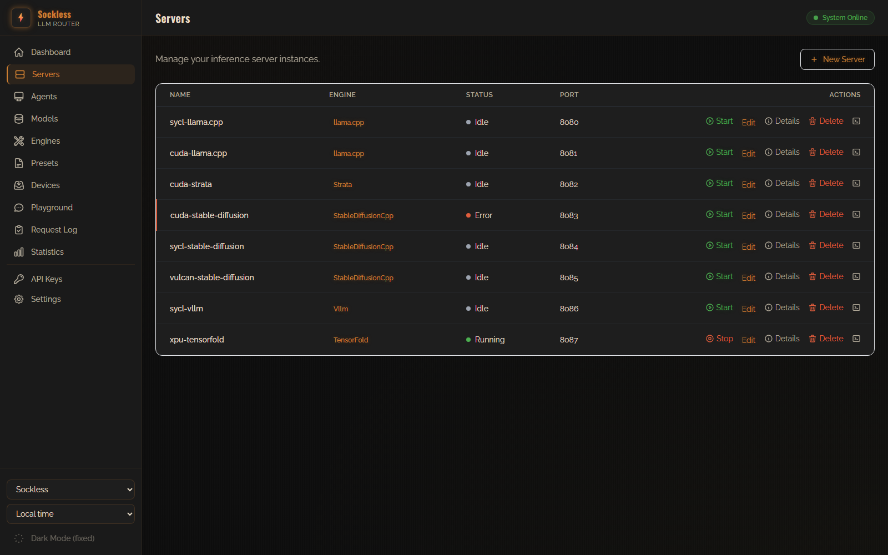 | 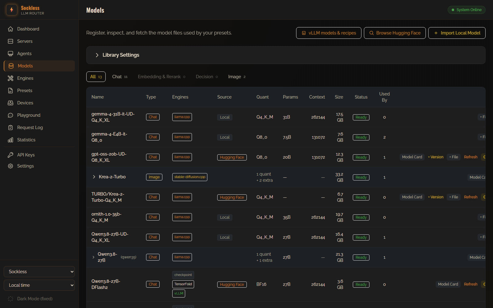 |
| **Engines: llama.cpp** — installed builds per backend and source recipes | **Engines: Strata** — installs, prepared models, update/rollback |
| 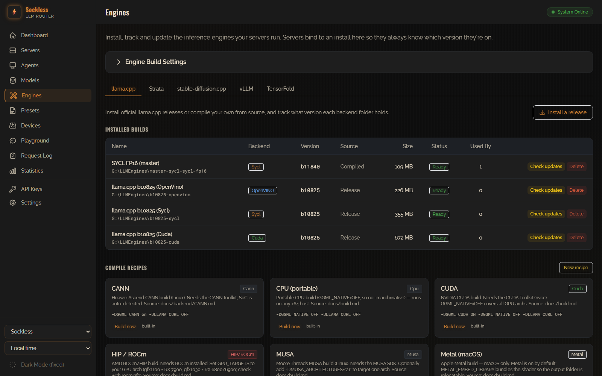 | 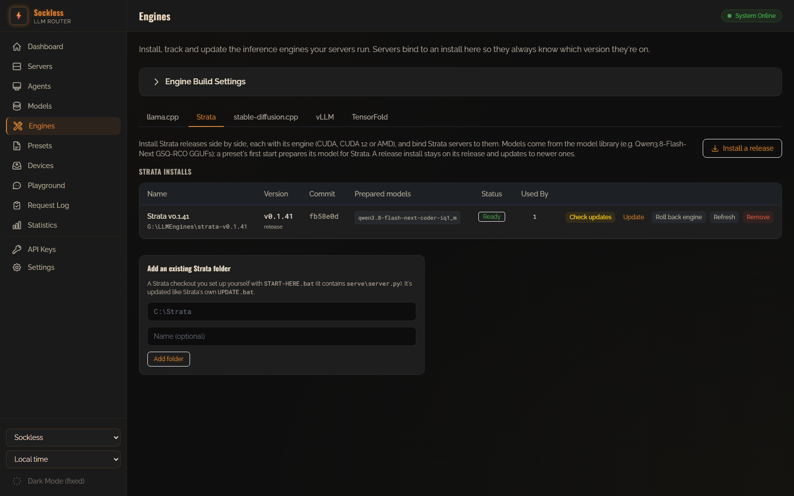 |
| **Engines: vLLM** — WSL and Intel XPU Docker installs | **Engines: TensorFold** — releases, the Intel XPU Docker image and CUDA/HIP/XPU recipes |
| 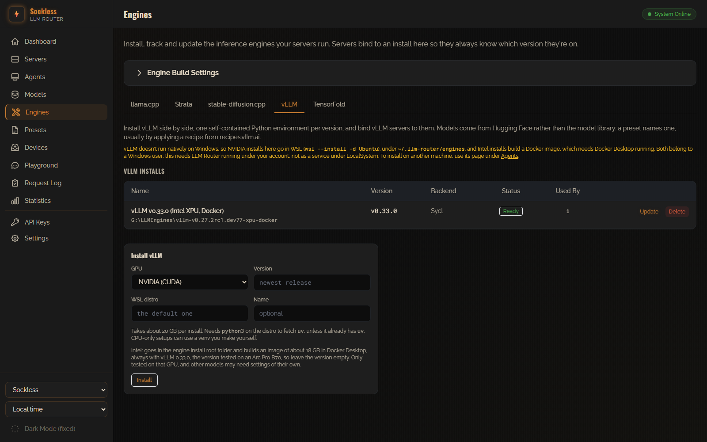 | 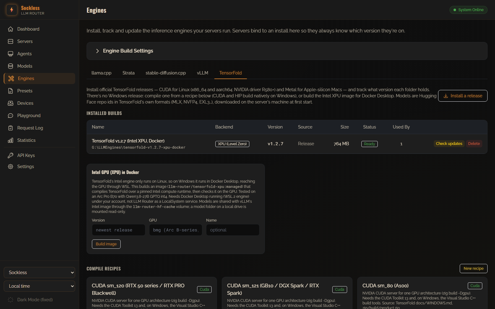 |
| **Engines: stable-diffusion.cpp** — release and compiled builds for image generation | **Devices** — GPUs on the machine, VRAM and likely compute APIs |
| 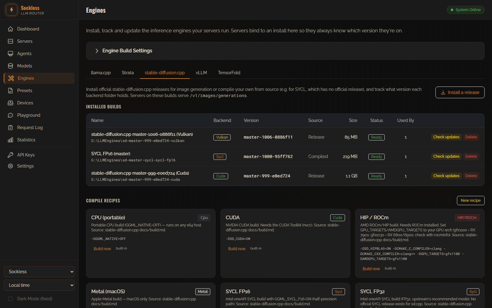 | 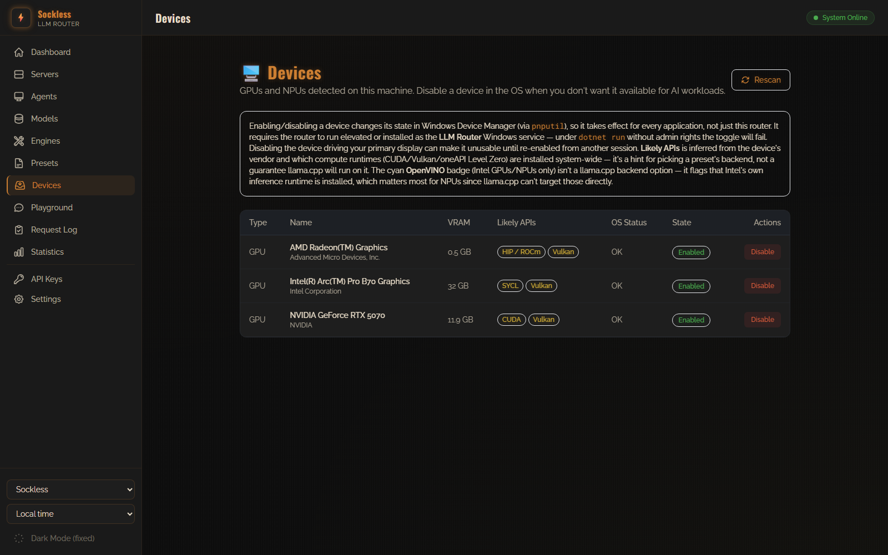 |
| **Presets** — launch configurations per server | **Playground** — run history comparing TTFT and speeds per configuration |
| 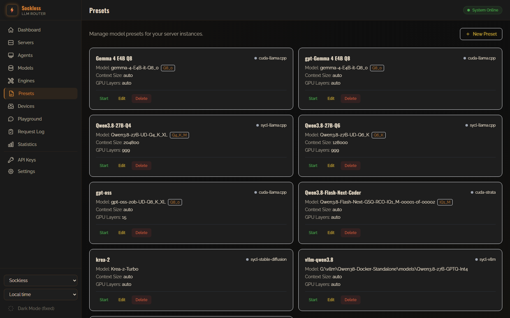 | 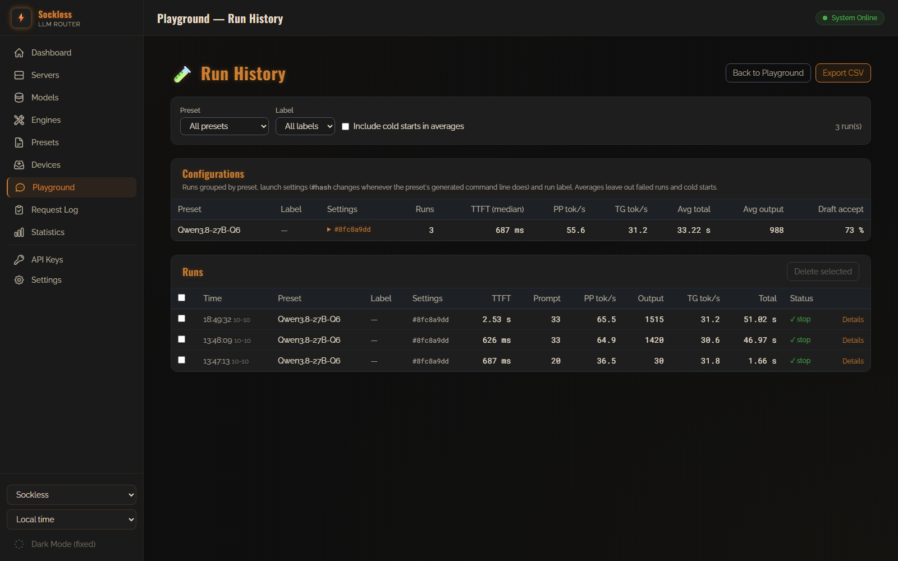 |
| **Statistics** — throughput, latency, context usage | **Request Log** — per-request history with filtering |
| 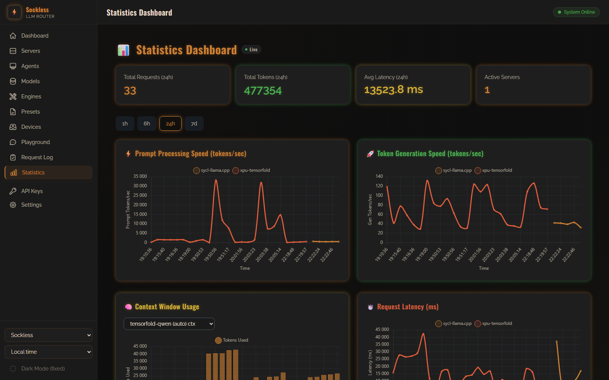 | 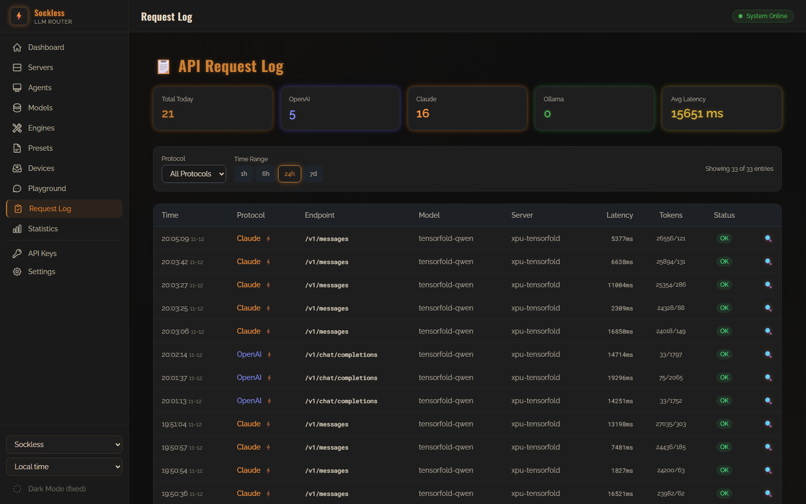 |
| **API Keys** — model-scoped keys, enable/disable, regenerate | |
| 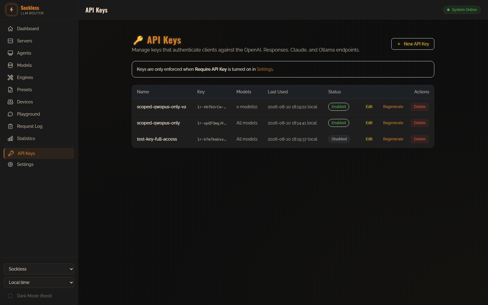 | |

## Architecture

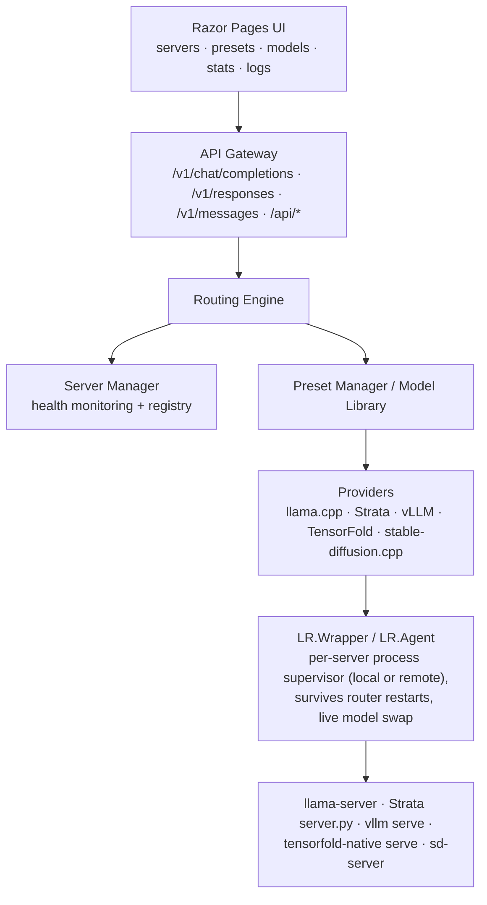

### Projects

| Project | Description |
|---|---|
| **LR.Application** | ASP.NET Core web app — Razor Pages UI, API endpoint mappings (OpenAI/Claude/Ollama/Responses), SignalR hubs, background services, Windows Service hosting |
| **LR.Core** | Core interfaces, EF Core models/migrations (SQLite), and services — routing engine, server/preset/model-library managers, Hugging Face client, request logging, wrapper protocol |
| **LR.Providers** | Backend engine providers: a shared base (`ManagedServerProviderBase` — wrapper process management, health, OpenAI/Anthropic request + SSE handling) with one folder per engine (`LlamaCpp/`, `Strata/`, `Vllm/`, `TensorFold/`, `StableDiffusionCpp/`) |
| **LR.Wrapper** | Standalone process that launches and supervises a backend server process over a named-pipe protocol, so a router restart doesn't kill the backend (the supervisor itself lives in `LR.Core/Wrapper`) |
| **LR.Agent** | Self-contained service for remote machines: connects out to the router over a WebSocket, relays the wrapper protocol to per-server wrapper processes it launches (`LR.Agent wrapper …`), runs engine-install and model-download jobs locally, and updates itself from the router |

## API

| Protocol | Endpoints |
|---|---|
| OpenAI | `POST /v1/chat/completions` (streaming + non-streaming, tool calling), `POST /v1/embeddings`, `POST /v1/images/generations`, `GET /v1/models`, `GET /v1/models/capabilities` (router extension: per chat preset, context size, output budget, tool/vision/reasoning support, and whether the model is loaded right now — `loaded` plus `load_state`: `loaded`, `loading`, `unloaded` or `error`) |
| System One (TypeSafe/Jev) | `POST /v1/systemone` (decision models; non-streaming) |
| OpenAI Responses | `POST /v1/responses`, `GET /v1/responses/{id}`, `DELETE /v1/responses/{id}`, `POST /v1/responses/{id}/cancel` |
| Claude | `POST /v1/messages` |
| Ollama | `POST /api/chat`, `POST /api/generate`, `GET /api/tags`, `POST /api/show`, `POST /api/embed`, `POST /api/embeddings`, `GET /api/ps`, `GET /api/version` |
| Misc | `GET /health`; SignalR hubs `/serverHub` and `/modelDownloadHub` for live UI updates |

Protocols are toggled via `Gateway:EnabledProtocols` in configuration (`/v1/systemone` is served with the OpenAI endpoints). Only `"function"`-type tools are supported for tool calling and the Responses API — OpenAI's built-in tools (web search, file search, code interpreter, computer use, image generation, MCP) and the Conversations API are not implemented.

## Getting Started

### Prerequisites

- .NET 10.0 SDK or later
- Node.js/npm (to build the Tailwind CSS bundle — see below)
- For llama.cpp servers: `llama-server`/`llama-server.exe` binaries for whichever backend(s) you plan to run (CPU/CUDA/Vulkan/SYCL) — downloaded/compiled from the Engines page or your own builds
- For Strata servers: Git and Python 3.10+, plus a C++ toolchain (Visual Studio Build Tools on Windows, `build-essential` on Linux) when Strata has to compile its engine — always on Linux, and on Windows only if no ready-made engine fits the PC. The Strata releases page checks these and refuses an install until they're found (installed from the Engines page — see [Strata servers](#strata-servers))
- For vLLM servers: Linux, or WSL on Windows (NVIDIA); Docker Desktop for Intel GPUs. See [vLLM servers](#vllm-servers)
- For TensorFold servers: nothing on Linux x86_64/aarch64 (NVIDIA driver R580+) or Apple-silicon macOS, where releases install as-is. On Windows, the CUDA Toolkit 13 or ROCm plus the Visual Studio C++ build tools to compile from a recipe, or Docker Desktop for Intel GPUs. See [TensorFold servers](#tensorfold-servers)

### Building the frontend assets

```bash
cd LR.Application
npm install
npm run build:css
```

### Running the Application

#### Standalone (console)

```bash
dotnet run --project LR.Application
```

The application will start, apply any pending SQLite migrations (`data/lr.db`), and serve the Razor Pages dashboard. Add servers, presets, and model-library entries from the UI — there's no need to hand-edit configuration for routing data.

#### As a Windows Service

The same executable can run under the Service Control Manager — it detects how it was
launched and adapts automatically (no separate build or flag required).

1. Download a release from the
   [GitHub Releases](https://github.com/sockless-coding/llm-router/releases) page and
   extract it to the folder the service should run from:

   - `llm-router-<version>-win-x64.zip` — framework-dependent; requires the
     [.NET 10 runtime](https://dotnet.microsoft.com/download/dotnet/10.0) (ASP.NET Core).
   - `llm-router-<version>-win-x64-self-contained.zip` — includes the runtime.

2. Install the service from the extracted folder (run PowerShell as Administrator):

   ```powershell
   .\install-service.ps1
   ```

   By default this creates a service named `LLMRouter` pointing at the
   `LR.Application.exe` in the same folder as the script. Pass `-PublishDir` to point
   at a different folder.

   To test a local build as a service, run `publish.bat` from the repo root (it
   publishes to `publish\`), then install with `.\install-service.ps1 -PublishDir .\publish`.

3. Start it:

   ```powershell
   Start-Service LLMRouter
   ```

   Logs go to the Windows Event Log (source `LLM Router`, log `Application`) since
   there's no console attached when running as a service.

4. To remove it (run as Administrator):

   ```powershell
   .\uninstall-service.ps1
   ```

#### Updating

**Settings → Updates** shows the installed version and the latest
[release](https://github.com/sockless-coding/llm-router/releases). When the router runs as a
Windows Service, **Install and restart** updates it in place:

1. The router downloads the release archive matching the install (framework-dependent or
   self-contained), checks its SHA-256 digest and extracts it to `data\updates\`.
2. It launches the new version's `LR.Application.exe` in updater mode. That process stops the
   service, copies the new files over the install folder and starts the service again.
3. If any file can't be replaced, everything is rolled back and the old version is restarted.

`data\` (database, wrapper state, engine builds) and an existing `appsettings.json` are never
overwritten. Requests in flight when the service stops are cut off. Running model servers keep
running, and the restarted router reconnects to them. Their wrapper processes keep the old
`LR.Wrapper.exe` until they're next restarted. The outcome is shown on the Settings page, and
`data\updates\update.log` has the details.

When the router isn't running as a service (console or `dotnet run`), the page still checks for
updates, but you install them by replacing the files yourself.

## Using the dashboard

- **Servers** — register backend server instances, pick their engine (llama.cpp, Strata, vLLM, TensorFold or stable-diffusion.cpp), bind them to an install from the Engines page, start/stop/restart them, and view live logs and status.
- **Presets** — define launch configurations (model path, context size, sampling parameters, GPU/threading, speculative decoding, LoRA, multimodal settings, etc.), optionally linked to a model-library entry so the model path and GGUF metadata stay in sync automatically.
- **Engines** — install official releases of each engine, compile llama.cpp / stable-diffusion.cpp / TensorFold from built-in or custom recipes, check for updates and update in place. Servers bind to an install, so they always know which version they run.
- **Model Library** — import existing `.gguf` and `.safetensors` files or Hugging Face checkpoint folders (`config.json`, tokenizer and safetensors shards), scan a folder for unregistered models, or search and download models from the Hugging Face Hub with live progress; inspect metadata per model. Models are classified from their GGUF metadata as chat, embedding, reranker, decision, image or a companion file (projector, VAE, text encoder…), filterable by tab, and badged with the engines that can run them; a preset's model picker only offers fitting ones.
- **Devices** — GPUs/NPUs on this machine with VRAM and likely compute APIs (CUDA, SYCL, Vulkan, HIP, OpenVINO), to help pick a preset's backend; devices can be disabled in Windows when they shouldn't be used for AI work.
- **Stats** — throughput, latency, and context-usage charts.
- **Playground** — chat with a preset and see per-reply performance stats (TTFT, prompt/generation tok/s, cached tokens, draft acceptance). Tag runs with a label (e.g. `fa=on ub=1024`), use *Repeat ×N* to average out noise, and compare configurations on the **Run history** page — runs are grouped by preset, label and a hash of the preset's generated command line, so editing a preset automatically starts a new group. Runs aren't subject to request-log retention. Decision presets open the **Decide** page and image/video presets the **Generate** page instead.

### System One decision models (Jev)

Decision models don't write an answer: given a **state** (a customer message, a document, a transcript, chat messages…) they score a set of typed **questions** in a single forward pass and return probabilities. llama.cpp serves them through its TypeSafe/Jev-compatible System One API, and the router puts that behind `POST /v1/systemone` with the same routing, auto-start, fallback, memory groups, queueing, API-key scoping and request logging as chat.

- **Models.** A GGUF with `{arch}.decision.type` in its metadata (e.g. `openjev`, `laya`, `kev`) is classified as a decision model on import, and the type follows it into presets linked to it. Decision-only models are left out of chat model listings (`/v1/models`, `/api/tags`), so chat clients never pick one; `granite-switch` models also generate text, so they're offered for both.
- **Questions.** Each question has a type: `choice` picks one of several options, `score` rates on a scale of 2–10 levels (lowest first), and `noul` gives the probability that the answer is yes.
- **Requests.** The body is llama-server's own shape and is forwarded as is, and the response (`answers`, `usage`) comes back unchanged. Streaming isn't supported. llama-server's endpoint takes no `model`, so a Jev client may not send one; the router then uses the only decision preset that the API key can reach, and asks for `model` when there's more than one.

```bash
curl http://localhost:5053/v1/systemone -H "Content-Type: application/json" -d '{
  "model": "openjev",
  "state": "Customer message: I was charged twice for my order last week and nobody has replied.",
  "questions": {
    "route":   { "type": "choice", "instructions": "Which team should handle this?", "criteria": { "billing": null, "shipping": null, "technical": null } },
    "angry":   { "type": "noul",   "instructions": "Is the customer angry?" },
    "urgency": { "type": "score",  "instructions": "How urgent is this?", "criteria": ["can wait", "this week", "today", "right now"] }
  }
}'
```

**Playground → Decide** builds the same requests interactively: write the state (as text, or as JSON with *State is JSON*), add questions, or load the example above, and see each answer's probabilities. You can also edit the request as raw JSON.
- **Request Log** — browse and filter logged API requests by protocol and time range.
- **Settings** — app-level configuration, including the model library's root folder and Hugging Face API token.

### Strata servers

[Strata](https://github.com/Niko1221/Strata) runs large Mixture-of-Experts models (Qwen3.8-Flash-Next) on consumer GPUs by offloading dormant experts to system RAM. It's set up the same way as llama.cpp:

1. **Engines → Strata → Install a release**: pick a release and its engine build — CUDA, CUDA 12 (older NVIDIA drivers) or AMD. The router clones that release into `<install root>/strata-<tag>-<engine>`, creates its `.venv` with Strata's pinned Python packages, and installs the engine, checked against the SHA-256 GitHub publishes for it. No model is installed. (Linux has no ready-made engines; Strata compiles one when a model is first prepared.)
2. **Models → Hugging Face**: download a Qwen3.8-Flash-Next GGUF, e.g. `ISTA-DASLab/Qwen3.8-Flash-Next-GSQ-RCO-GGUF` → `IQ3_XXS` (Swift 1.5, the Coder and Unsloth's quants work too). Split models are one entry: all shards are downloaded together.
3. **Servers**: create a server with engine **Strata**, bound to the install.
4. **Presets**: pick the model from the library and, in the **Strata** section, the context length, GPU, images, KV cache type, low-RAM mode and parallel requests (blank = Strata's recommendation for this PC). Start it.

The first start of a preset prepares its model for Strata with Strata's own `setup.py` in its existing-GGUF mode (`--gguf-dir`): it builds the model's pack, downloads the ~5 GB MTP draft layer once (shared by all models), and writes a run config tuned to this PC, which the router keeps per preset. Progress shows in the server's start status and log. This can take several minutes (longer in low-RAM mode, which writes the experts into one 35–77 GB file once); later starts skip it until the model, the preset's Strata settings or the install change. Prepared packs and the draft layer live in Strata's shared `Strata-data` folder next to the install. The server then runs as Strata's own `run-<model>` scripts would — `.venv` Python with `serve/server.py --engine strata --config <run config>` — on the router-assigned port, bound to `127.0.0.1`.

The Strata tab shows each install's version, commit, engine version and prepared models. It can check for updates (a release install against the latest release), update in place (a release install checks out the new tag and installs that release's same engine build; refused while a server is running from it), roll back the engine, or stop tracking an install (its files are never deleted). A Strata folder you set up yourself with `START-HERE.bat` can be added too; it updates like Strata's `UPDATE.bat`, and a preset can also point straight at one of its `strata-<model>.json` run configs.

If a run config (or `STRATA_API_KEY`) sets an API key, the router sends it automatically. Strata's `/props` and `/slots` mirror llama.cpp's, so slot-based concurrency limits, context-aware queuing, and the dashboard's slot/KV usage work the same as for llama.cpp servers.

### vLLM servers

[vLLM](https://github.com/vllm-project/vllm) serves Hugging Face models on the GPU, with its own batching. It only runs on Linux, so **on Windows the router runs it inside WSL** (`wsl --install -d Ubuntu`; the GPU comes through from the Windows NVIDIA driver, nothing to install in the distro), or for an Intel GPU, in Docker Desktop (see below).

1. **Engines → vLLM → Install**: pick the GPU and optionally a version (blank = the newest on PyPI). Each install is a self-contained folder holding its own `uv`, Python 3.12 and venv: `<install root>/vllm-<version>-<backend>` on Linux, `~/.llm-router/engines/…` in the distro on Windows, tracked by its `\\wsl.localhost\…` path. It needs `python3` on the target to fetch `uv`, unless `uv` is already there. CPU-only setups aren't offered, because vLLM's CPU wheels need a hand-set `LD_PRELOAD`; a server can point straight at a venv you made yourself instead.
2. **Servers**: create a server with engine **vLLM**, bound to the install. A remote agent works the same way.
3. **Models → vLLM models & recipes** (optional, recommended): add the Hugging Face models you serve with vLLM, by searching recipes.vllm.ai and the Hub, then save recipes under each model: recipes.vllm.ai's command for a hardware/variant/strategy choice, or your own (there's a template for Qwen3.8 on an Arc Pro B70). The hardware filter shows only recipes for one GPU profile, and suggests the profiles that match this machine's GPUs. Filtering the recipe site by hardware reads every recipe once, then caches the result for 12 hours. A site recipe can be refreshed later; editing it makes it custom. **Create preset** on a recipe opens a new preset filled in from it.
4. **Presets**: in the **vLLM** section, pick one under **Start from a saved recipe**, or search for a model under **Or load one from recipes.vllm.ai**, choose its variant, hardware, strategy and features, and **Fill in the preset**. A preset copies a saved recipe's settings and remembers which recipe it came from; changing the recipe later doesn't change the preset (pick it again to update). Recipes come from [recipes.vllm.ai](https://recipes.vllm.ai) and are read once, by the router, when applied: their command fills in the form for you to review, and a saved preset never needs the site. You can also type a Hugging Face id or a model folder and fill the fields in by hand.

Things to know about recipes:

- **The form says what the site changed.** Recipes only list hardware they're tested on, and the site quietly falls back for anything else (an RTX 5090 request for a CPU-validated recipe comes back tuned for a Xeon). Consumer GPUs usually get a data-centre recipe with the right flags; check the context length and GPU memory share against your card.
- **Nothing from a recipe runs until you save and start the preset, and some of it is left out.** Flags the router owns (`--host`, `--port`, `--api-key`, `--served-model-name`, …) and variables like `LD_PRELOAD`, `PATH` or `HF_TOKEN` are dropped and reported. `--trust-remote-code` is kept but called out, since it runs Python from the model's repository. A recipe's extra install steps are shown, not run. `VLLM_USE_RUST_FRONTEND` is also left out, because that frontend rejects Anthropic-format requests; add it to the preset's environment variables if only OpenAI-format clients use it.
- **Multi-node strategies aren't available**: a router server is one machine.

#### Intel GPUs (Windows, Docker Desktop)

Pick **Intel (XPU, Docker)** when installing to run vLLM on an Intel GPU such as the Arc Pro B70. A venv in WSL doesn't work on these cards, so this runs vLLM's own XPU image in Docker Desktop instead, and works alongside an NVIDIA card in the same PC. It needs Docker Desktop running its Linux/WSL 2 engine and an engine install root folder. LLM Router can run as a LocalSystem service (it talks to the engine's named pipe directly), but Docker Desktop only runs while its user is signed in.

- **The install** is `<install root>/vllm-v<version>-xpu-docker`, which holds the build files; the image itself (`llm-router/vllm-xpu:managed`, about 18 GB) lives in Docker. The install builds it, then checks that it can compute on the GPU.
- **The version is fixed**, because the image's fixes patch vLLM's source. **Update** rebuilds the image, picking up whatever a newer LLM Router pins.
- **Models**: a Hugging Face id downloads into the Docker volume `llm-router-hf-cache`, which deleting the install leaves in place; a folder must be on a local drive (`D:\models\qwen`) and is mounted read-only. Network and `\\wsl.localhost` paths can't be mounted.
- **Each server is a container** named `llm-router-vllm-<port>`, removed when the server stops. Published on loopback, or on all interfaces for a remote agent. Environment variables are passed by name, so their values don't appear on the `docker` command line.
- **Qwen3.8-27B GPTQ INT4**: in the preset's **vLLM** section, **Fill in Qwen3.8 on Arc Pro B70** sets up MTP speculative decoding with 4 tokens, a 100K context and low reasoning by default. That model's own template defaults to `xhigh` reasoning, which writes far more before it answers; a request can still ask for more with `reasoning_effort`. For long-running sessions, the patches' authors recommend removing `B70_DRAFT_LMHEAD_INT4` and `B70_DRAFT_MTP_INT4` from the environment variables, to keep speculative acceptance stable.
- **XPU graphs are off**: vLLM would capture them, but the GPU as WSL presents it can't record them, and the server crashes while starting. `LR_XPU_GRAPH=1` in a preset's environment variables turns them back on, for a driver that supports them.
- **Only tested with an Arc Pro B70.** Settings that suit one model may not suit another, and the first GPU is the only one used.

The image's MTP patches are from the MIT-licensed [Intel Arc Pro B70 inference cookbook](https://github.com/SergiioB/intel-arc-pro-b70-inference-cookbook), unmodified except that `patch_mtp_boundary.py` was brought up to vLLM 0.33.0 (its header says what changed), with its licence alongside them in `LR.Core/Services/EngineBuilds/VllmXpuPatches`.

A first start downloads the model into the Hugging Face cache of the machine the server runs on, so the startup timeout is 4 hours; gated models use the Hugging Face token from the model library settings. Models don't come from the model library, whose entries are single files. Clients ask for the preset's name or aliases as usual; the router rewrites `model` to the fixed name each server is started under, because vLLM rejects any other. vLLM has no llama.cpp-style `/props` or `/slots`, so the dashboard shows no slot or KV usage for it, and the router's in-flight limit is the preset's **Max concurrent requests** (default 64).

**WSL limitations.** WSL distros belong to a Windows user, so the router or agent has to run under that user's account, not as a service under LocalSystem (the default for both installers); otherwise it sees no distros. On a remote Windows agent the router also has to reach the server over the network, and WSL's default NAT networking only forwards to the Windows machine itself: use `networkingMode=mirrored` in that account's `.wslconfig` and allow the port through the Hyper-V firewall. Alternatively, a server can point at a native venv of the community [vllm-windows](https://github.com/SystemPanic/vllm-windows) fork (`.venv\Scripts\vllm.exe`), which needs no WSL but isn't installed or updated by the router.

### TensorFold servers

[TensorFold](https://github.com/ashhart/TensorFold) is a native inference server (`tensorfold-native serve`) for Hugging Face checkpoints in its own formats (MLX, NVFP4/FP8, EXL3, …), with external-drafter speculative decoding and a prompt cache. It serves OpenAI-compatible `/v1/chat/completions` and Anthropic-compatible `/v1/messages` itself, and the router reads token counts from its streamed usage events.

1. **Engines → TensorFold**, one of:
   - **Install a release**: official builds for Linux x86_64 / aarch64 (CUDA 13, NVIDIA driver R580+) and Apple-silicon macOS (Metal), checked for updates and updated in place like llama.cpp builds. Works on [agents](#remote-agents) too.
   - **Compile from a recipe**: there's no Windows release, so built-in recipes build one with `zig build`: CUDA per GPU architecture (`sm_120` RTX 50 / RTX PRO Blackwell, `sm_121` GB10 / DGX Spark, `sm_80` A100, …), HIP per AMD architecture (`gfx1151` Strix Halo, …) and Intel XPU (Linux only, Level Zero). The pipeline fetches Zig and the other pinned build tools itself. CUDA needs the CUDA Toolkit 13 and, on Windows, the Visual Studio C++ build tools.
   - **Intel GPU (XPU) in Docker** (Windows): builds the image `llm-router/tensorfold-xpu:managed`, which compiles TensorFold over a pinned Intel compute runtime (checked by SHA-256), then verifies it computes correctly on the GPU. Needs Docker Desktop running on its WSL 2 engine; a LocalSystem service can use it while Docker Desktop's user is signed in. Not available on agents.
2. **Models** (optional): download a checkpoint folder from the Hugging Face browser (`config.json`, tokenizer and safetensors shards). The Models page badges checkpoints as runnable by TensorFold (and by vLLM, unless they're MLX-quantized).
3. **Servers**: create a server with engine **TensorFold**, bound to the install.
4. **Presets**: set the model to a Hugging Face repo id (e.g. `TensorFold/Qwen3.8-27B-MLX-4bit`, optionally pinned with `@revision`), a library checkpoint, or a checkpoint folder on the server's machine. In the **TensorFold** section, set context, parallel requests, max tokens, thinking on/off, reasoning effort, vision, an optional **drafter** for speculative decoding (e.g. `z-lab/Qwen3.8-27B-DFlash2`, picked from the library or given as a folder / cached repo id), prompt cache size, extra arguments and environment variables.

How it runs:

- **Models are pulled on first start.** `serve` never downloads, so on Linux and macOS the router pulls a repo id into the Hugging Face cache of the server's machine first: when it's missing (the default), always, or never, per preset. A first start can download a whole checkpoint, so the startup timeout is hours. On a Windows source build the server launches directly, so pull the repo id first. Gated models use the Hugging Face token from the model library settings.
- **Fixed served name.** Every server runs as `router-model` and the router rewrites each request's `model` to it, so clients keep using the preset's name or aliases.
- **Capacity and memory groups.** TensorFold has no `/props` or `/slots`; the router reads the resolved context window from `/v1/models` and limits in-flight requests to the preset's parallel count (default 8). Checkpoints aren't single files to measure, so set **Memory needed (GB)** for memory-group budgeting.
- **Intel XPU in Docker.** Each server is a container named after its port, removed when the server stops. A model folder on a local drive is mounted read-only; repo ids go into the `llm-router-hf-cache` volume, shared with vLLM's Intel image. The image sets `NEOReadDebugKeys=1` and `AllowUnrestrictedSize=1`, without which loading fails through WSL with `ZE_RESULT_ERROR_UNSUPPORTED_SIZE`. If loading aborts in `wddm_memory_manager.cpp`, set the preset's **Intel WDDM chunk size** to 4096. On XPU the prompt cache uses GPU memory, so lower it if a long context doesn't fit. Tested on an Arc Pro B70 with Qwen3.8-27B GPTQ int4.

### Image generation (stable-diffusion.cpp)

[stable-diffusion.cpp](https://github.com/leejet/stable-diffusion.cpp) servers generate images and follow the same server → engine → model → preset flow as the LLM engines:

1. **Engines → stable-diffusion.cpp → Install a release**: pick a release and a backend (CPU, CUDA, Vulkan, ROCm on Windows; CPU, Vulkan, ROCm on Linux; Metal on macOS). Windows CUDA builds come with their CUDA runtime. Installs can be checked for updates and updated in place like llama.cpp builds. For a backend with no official release (e.g. **SYCL** for Intel GPUs), compile one from a **recipe** on the same tab — built-ins cover CPU, CUDA, Vulkan, SYCL FP32/FP16, HIP and Metal, taken from sd.cpp's `docs/build.md`, and work exactly like llama.cpp recipes (duplicate and adjust, rebuild/update from source).
2. **Models**: import the model files — `.gguf` or `.safetensors`. A full checkpoint (SD 1.x/2.x/SDXL) is one file; a standalone diffusion model (Flux, SD3, Qwen-Image, Z-Image…) also needs its VAE and text encoder(s). In the Hugging Face browser, **Show Files** on a repo of a known family (FLUX.1, SD3, SDXL, SD 1.x/2.x, Qwen-Image, Z-Image, Wan) lists every part it needs (already in your library, in this repo, or a link to a repo that has it) and labels each file as model, VAE, text encoder, TAESD or LoRA.
3. **Servers**: create a server with engine **stable-diffusion.cpp**, bound to the install.
4. **Presets**: pick the main model and, in the **Diffusion** section, its VAE/text encoders (CLIP-L, CLIP-G, T5-XXL, LLM), the default size, steps, CFG scale, sampler, scheduler, seed and negative prompt, and performance options (weight type, flash attention, CPU offload, VAE tiling, …). Picking a model of a known family fills in its VAE/text encoders from the library, how it's loaded (`-m` or `--diffusion-model`) and the family's recommended CFG/sampler/flow shift. It only fills empty fields or ones it filled itself, and lists any part that's still missing with where to download it. The command preview shows the resulting `sd-server` command line.

Clients call `POST /v1/images/generations` with the preset's name (or an alias) as `model`:

```bash
curl http://localhost:5053/v1/images/generations -H "Content-Type: application/json"   -d '{"model": "flux-schnell", "prompt": "a lighthouse at dusk", "size": "1024x768", "n": 1}'
```

The response is OpenAI's `{"created": ..., "data": [{"b64_json": "..."}]}` (images are always returned as base64; `response_format: "url"` isn't supported). Besides `prompt`, `n`, `size` and `output_format`, the router accepts the common extras `negative_prompt`, `seed`, `steps`, `cfg_scale`, `guidance`, `sampler`/`sample_method` and `scheduler`, and passes them to stable-diffusion.cpp as `<sd_cpp_extra_args>`; a client's own `<sd_cpp_extra_args>` block in the prompt still works and wins. Anything a request doesn't set falls back to the preset's defaults.

Image presets are kept apart from chat: they don't appear in `/api/tags` or `/v1/models/capabilities`, a chat request naming one gets a 400 pointing at the images endpoint, and unresolved chat models are never round-robined onto an image server (or the reverse). `sd-server` generates one image job at a time, so the router sends each server one request at a time and queues the rest. A preset's memory-group footprint is its model files plus compute buffers (only the largest file with CPU offload). Request-log entries keep the request and a summary of the response, with the base64 image data left out.

**Playground → Generate**: picking an image or video preset in the Playground opens the Generate page, which runs on stable-diffusion.cpp's native job API rather than the OpenAI endpoint, so it can show sampling progress with live previews and take image inputs. It offers image mode (batch size, image-to-image with strength, inpainting masks) and video mode (frames, FPS, start/end frames; Wan, LTX, HunyuanVideo and other video models), plus size, steps, CFG, guidance, sampler, scheduler, seed, LoRAs from the server's LoRA folder, output format and preview mode. Once the model is loaded, the page reads the server's capabilities to show only the modes and inputs it supports, list its samplers and LoRAs, and use its defaults as placeholders. A generation goes through routing like any request (model auto-start, fallback, memory groups) and holds the server's slot until the job ends, so idle unload and memory-group eviction leave it alone mid-job; Stop (or leaving the page) cancels the job on the server. Results stay on the page until you leave; download the ones to keep. Each generation is written to the request log with images left out.

### Remote agents

An agent is a small service on another machine that runs servers for this router. Everything is
controlled from the router: the agent installs llama.cpp / stable-diffusion.cpp / vLLM / TensorFold builds and models
on its own disk, starts and stops backends, and updates itself.

**Adding a machine.** Open **Agents**, check the router URL (it must be reachable from the other
machine; a `localhost` address is flagged), and copy one command:

```sh
# Linux (x86_64 or aarch64), as root — installs to /opt/lr-agent, data in /var/lib/lr-agent, systemd unit lr-agent
curl -fsSL http://router:5053/agent/install.sh | sudo sh -s -- <enrollment-token>
```

```powershell
# Windows (x64 or arm64), elevated PowerShell — installs to Program Files\LR Agent, data in ProgramData\LR Agent, service LRAgent
& ([scriptblock]::Create((irm 'http://router:5053/agent/install.ps1'))) -Token '<enrollment-token>'
```

The script downloads the right package from the router, registers a service, and the machine
appears on the Agents page within seconds. The enrollment token is only used for first contact:
each agent gets its own secret (stored hashed on the router). Running the command again on the same
machine upgrades it in place and keeps its identity. Regenerating the token doesn't affect enrolled agents.

**Using it.** On an agent's page you can install a prebuilt engine release (only backends published
for that machine's OS/arch are offered) or compile one from a recipe, download a model from Hugging
Face straight onto the agent, copy one from the router's library, or register a file already there.
Then create a server with **Runs on: Agent …**, bind it to the agent's build, and give it a preset
with one of the agent's models. The preset form only offers models on the server's machine. Routing,
fallbacks, idle unload, memory groups and stats work exactly as for local servers. Engine/model rows
of agents also show up (with a badge) on the Engines and Models pages, and their progress and build
logs are live there too.

**How it works.**

- The agent dials out to `/agent/connect` (WebSocket), so it works from behind NAT. The router relays
  the same wrapper protocol it uses locally over that socket. Each server gets its own wrapper process
  on the agent, so restarting or updating the agent, or losing the connection, never stops a backend.
  When the agent reconnects, the router re-attaches to whatever kept running. Likewise after a router
  restart, where agent servers show as *Reconnecting* until their agent is back.
- Inference traffic goes **directly** from the router to the backend at `http://<agent address>:<port>`.
  Remote backends listen on `0.0.0.0`, so make sure the router can reach the servers' ports (8080 and
  up by default). The Windows installer opens 8080-8199 in the firewall. The address defaults to the
  one the agent connects from and can be overridden per agent.
- **Auto-update:** the router serves agent packages from `agent-packages/` next to the app. Release
  downloads include them, built at the router's version. An agent with auto-update on (the default)
  that reports a different version is sent the package on connect. It verifies the SHA-256, swaps its
  files and restarts (systemd `Restart=always` / service recovery). **Update now** on an agent's page
  does the same on demand.
- For a local build, run `.\publish-agents.ps1` from the repository root. It publishes the agent for
  win-x64, win-arm64, linux-x64 and linux-arm64 into the dev router's `agent-packages/` with a unique
  dev version, so connected agents pick the build up right away. Use `-Rids linux-x64` to build only one.

Limitations: Strata servers can't run on agents yet (its model preparation runs Python against local
files), and neither can TensorFold's Intel XPU Docker image. Agent traffic uses the admin port. With a separate routing port, agents connect to `Gateway:Port`.
The backends' HTTP port has no authentication of its own, so keep agents on a trusted network.

### Adding another engine

1. Add a value to `ServerEngine` (append; values are persisted).
2. Implement an `IBackendProvider`. For an engine that runs as a local OpenAI-compatible HTTP server, derive from `ManagedServerProviderBase` and implement `BuildLaunchSpec` (what to launch) plus `IsModelLoadedLine`/`TryParseListeningPort` (how its output signals readiness); override the optional hooks for request headers, out-of-band metrics, or a longer startup timeout.
3. Implement an `IEngineDescriptor` (display name, what it generates — `EngineModality.Text` or `Image`, provider type, install-folder help and validation, what a preset's model path means, and its preset-form section if its settings live in `ModelPreset.EngineSettings`) and register it in `ServiceCollectionExtensions.AddBackendEngines`.
4. Optionally, version management on the Engines page: an `IEngineInstallHandler` (upstream repo, how to tell a ready install from a missing one, what to compare updates against), and a tab partial `Pages/Features/Engines/Tabs/_<Engine>.cshtml`. An engine that publishes prebuilt server binaries on GitHub releases only needs an `EngineReleaseProfile` (repo, asset patterns per backend/OS, executable name — see `SdCppReleaseProfile`) to reuse the release install/update pipeline and the shared `_ReleaseBuilds` table; anything else gets its install/update jobs in an `EngineBuildService` partial (see `EngineBuildService.Strata.cs`). Installs are rows in `EngineBuilds` with their `Engine` set, so servers bind to them the same way for every engine.

The server pages, Engines tabs, provider factory, routing, and dashboards pick the new engine up from the catalog. Implementing `IServerCapacityProvider` (which the base class does) opts it into slot-based concurrency gating.

## Configuration

Edit `LR.Application/appsettings.json` for gateway-level settings (port, enabled protocols, request queueing/timeouts, request logging). Servers, presets, and the model library are managed through the dashboard and persisted to a local SQLite database (`data/lr.db`), not in `appsettings.json`.

## License

This project is licensed under the MIT License — see the [LICENSE](LICENSE) file for details.
